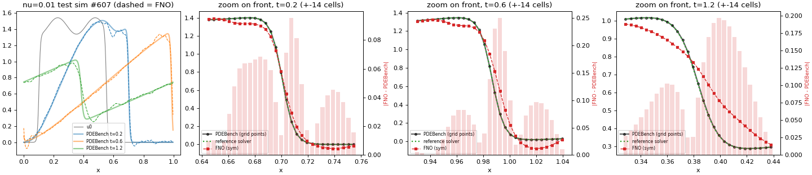

# PDE Solutions as a Service: 1D Burgers + Fourier Neural Operator

A web application that predicts the solution of the 1D viscous Burgers equation from a
user-supplied initial condition, using a Fourier Neural Operator (FNO) trained on the
official **PDEBench** dataset, and checks the prediction against an independent,
validated numerical solver.

> **Deployment status:** not deployed by me. The repository contains a Dockerfile
> intended for Render (it honours `$PORT`). It has not been built locally (no Docker
> on the development machine), so the first real image build will be on the host.

## The problem

```
u_t + (u^2 / 2)_x = (nu / pi) u_xx,    x in [0, 1) periodic,   t in [0, 2]
```

This is the PDEBench convention (diffusion coefficient `nu/pi`). It was **verified, not
assumed**: our own solver reproduces stored PDEBench trajectories only with `D = nu/pi`
(rel. L2 ~1e-3), while `D = nu` is ~130x worse (`scripts/validate_solver.py`).

## What the model does

| | |
|---|---|
| Input  | `(B, 256, 2)` = `[u(x, 0), x]` on the grid `x_j = (j + 0.5) / 256` |
| Output | `(B, 256, 10)` = `u(x, t)` at `t = 0.2, 0.4, ..., 2.0`; **supported window t <= 1.0** (later times low confidence, see Results) |
| Viscosity | **one model per nu**; only `nu = 0.1` is **served**. `nu = 0.01` was trained and evaluated but fails the accuracy rule (see Results), so it and all other values are rejected (HTTP 422). |
| Architecture | FNO1d: lift -> 4 x (spectral conv on 16 lowest Fourier modes + pointwise conv) -> projection; 551k real parameters |
| Physics constraint | the spatial mean of each output is set to mean(u0) (exact conservation law of periodic Burgers) |
| Loss | MSE (with the mean fixed, this acts on the evolving fluctuation) |

Why these choices:
* **Direct map u0 -> all snapshots** (not autoregressive): one forward pass gives the
  space-time field, no step-to-step error accumulation. At nu = 0.01 this formulation
  misplaces shocks increasingly with t (see the nu = 0.01 analysis).
* **256 grid** (stride 4 of PDEBench's 1024): the nu = 0.1 solutions are smooth; the
  reference solver gives the same accuracy at 256 and 1024 points.
* **MSE, not per-sample relative L2.** At nu = 0.1 the field decays quickly to its
  (conserved) mean, so a full-field relative loss rewards predicting the mean. A
  per-sample relative loss on the fluctuation would divide by near-zero fluctuations and
  fit numerical ripples in the data.

## Data

* Source: PDEBench 1D Burgers, DaRUS `doi:10.18419/darus-2986`, files
  `1D_Burgers_Sols_Nu0.1.hdf5` (DaRUS file id 268185) and `1D_Burgers_Sols_Nu0.01.hdf5`
  (281363); each 8.23 GB, 10000 simulations x 201 times x 1024 points, same layout.
* The HDF5 layout was inspected **without downloading the file**
  (`scripts/inspect_remote_hdf5.py`: the first/last 64 KB placed in a sparse local file and
  read with h5py). `tensor` is contiguous little-endian float32 at byte offset 2048.
* Only what is needed is downloaded with HTTP range requests
  (`scripts/download_subset.py`): the first **1200 simulations**, time indices
  `0, 10, ..., 200` (t = 0, 0.1, ..., 2.0): ~100 MB instead of 8.2 GB.
* Verified (`scripts/verify_download.py`): shapes, 0 NaN/Inf, and a byte-offset check
  through h5py's own layout logic (whole samples 0/600/1199 bit-identical to the
  row-wise download); conservation of the mean.
* The nu = 0.1 and nu = 0.01 files contain **identical initial conditions** (all 1200
  u0 bit-identical in our subset). Each nu has its own model, and the seed-0 split is by
  sample index, so a simulation is in the same split for both viscosities. A future
  multi-nu model must keep this property to avoid leakage across files.
* **Split by whole simulation**, seed 0: 900 train / 100 validation / 200 test; overlap
  0/0/0 (checked at training time; training aborts on any overlap). The test split is
  evaluated once, with the best-on-validation checkpoint.

## Independent validation: the reference solver

`src/pde_service/solver/burgers.py`: Fourier pseudo-spectral, 2/3 dealiasing,
integrating-factor RK4 (diffusion integrated exactly), adaptive CFL step.

| Check | Result |
|---|---|
| Exact Cole-Hopf solution | rel. L2 ~1e-12 |
| 30 PDEBench trajectories, 1024 and 256 points | mean rel. L2 1.0e-3, max abs. error <= 5e-3 |
| Control: `D = nu` | rel. L2 1.3e-1 (rejected) |
| 30 PDEBench trajectories at nu = 0.01, 1024 / 256 points | mean rel. L2 3.1e-4 / 3.7e-4; fluctuation error <= 0.53 % at every t; `D = nu` control 1.6e-1 |
| Control: no convection / mean-advection only / c = 0.5 / c = 2 | fluctuation error 0.26-0.72 at t = 0.1 vs **3.4e-4** for full Burgers |

The convection controls (`scripts/convection_controls.py`) show the nonlinear term is
essential at nu = 0.1: in the PDEBench data `|u' u_x| / |D u_xx| ~ 0.55` for t = 0.1-0.4,
and dropping convection gives 72 % error already at t = 0.1. Energy is dissipated only by
diffusion, but convection (steepening) sets the rate.

**Known limitation of the comparison:** ~96 % of the fluctuation energy is gone by t = 0.5.
The stored PDEBench fields also contain small (~5e-4) ripples that do not decay, most
likely an artefact of PDEBench's own numerical scheme (observed, cause not verified). As a
result, relative errors on the late-time fluctuation are a few percent even for the
reference solver (5.4 % at t = 2 on the 200 test simulations; 6.9 % on the 30-sample check).
The excess ripple in PDEBench is small: RMS of modes k >= 3 is 1.1e-4 at t = 2 vs 4.9e-5 in
the solver.

## Results (real PDEBench, held-out test split)

From `artifacts/metrics_nu0.1.json` (200 held-out simulations, never used for training or
model selection; best-on-validation checkpoint, epoch 274/300; 55 min on a 2-core i3 CPU).

| Full space-time field (t = 0.2 ... 2.0) | **FNO** | Mean-only baseline u = mean(u0) |
|---|---|---|
| MSE | **9.06e-6** | 1.08e-2 |
| RMSE | **3.01e-3** | 1.04e-1 |
| Relative L2 | **0.46 %** | 25.4 % |
| Fluctuation rel. L2 (pooled, `‖pred−ref‖ / ‖ref−mean‖`) | **2.9 %** | 100 % |

Per simulation, relative L2: median 0.28 %, p90 1.11 %, max 2.33 %.

Fluctuation relative L2 per output time, FNO vs the reference solver's own agreement with
PDEBench (`artifacts/convection_controls_nu0.1.json`):

| t | 0.2 | 0.4 | 0.6 | 1.0 | 1.6 | 2.0 |
|---|---|---|---|---|---|---|
| FNO vs PDEBench | 2.1 % | 2.5 % | 2.5 % | 4.3 % | 9.0 % | 11.9 % |
| reference solver vs PDEBench | 0.04 % | 0.20 % | 0.44 % | 1.0 % | 3.2 % | 6.9 % |

Interpretation:
* The FNO clearly learned the dynamics: ~55x lower relative L2 than the mean-only baseline.
* It is ~50x less accurate than the numerical solver at early times; it is ~8x faster
  (16 ms vs 135 ms per prediction on the 256 grid). That is the surrogate trade-off.
* The late-time growth of the relative error is mostly the signal fading, not the error
  growing; but the late-time error is the FNO's own, not the data floor (see below).
* Generalisation gap: final train MSE ~1.7e-6 vs test MSE 9.1e-6 (mild overfitting).
* Out-of-distribution example: a k = 24 initial condition triggers the API warning and
  the FNO is 38 % off the solver. The warning is warranted.

### Supported time window (nu = 0.1): t <= 1.0

`scripts/error_vs_time.py` (200 test simulations, `artifacts/error_vs_time_nu0.1.json`):

| t | 0.2 | 0.6 | 1.0 | 1.4 | 2.0 |
|---|---|---|---|---|---|
| RMS of true fluctuation (PDEBench) | 0.235 | 0.112 | 0.062 | 0.036 | 0.017 |
| RMSE FNO vs PDEBench | 4.9e-3 | 2.8e-3 | 2.7e-3 | 2.7e-3 | 2.0e-3 |
| RMSE FNO vs solver | 4.9e-3 | 2.9e-3 | 2.7e-3 | 2.8e-3 | 2.1e-3 |
| RMSE solver vs PDEBench | 1.2e-4 | 5.0e-4 | 6.2e-4 | 6.0e-4 | 9.0e-4 |
| Fluct. rel. L2 FNO vs PDEBench | 2.1 % | 2.5 % | 4.3 % | 7.5 % | 11.9 % |
| Ripple RMS (modes k >= 3): PDEBench / FNO / solver | 3.6e-2 / 3.6e-2 / 3.6e-2 | 8.9e-3 / 8.7e-3 / 8.8e-3 | 2.1e-3 / 2.0e-3 / 2.1e-3 | 4.7e-4 / 7.6e-4 / 4.7e-4 | 1.1e-4 / 6.2e-4 / 4.9e-5 |

* The FNO's **absolute** error is roughly flat (2-5e-3) while the true fluctuation decays
  14x, so the **relative** error grows from 2 % to 12 %. Most of that growth is the
  denominator, but the error stops decreasing after t ~ 0.6 while the signal keeps decaying.
* The late-time error belongs to the FNO: the FNO is equally far from PDEBench and from
  the solver, while the solver and PDEBench agree 2-40x more closely.
* About 90 % of the FNO's late error energy is in the large-scale modes k = 1-2; ~10 % is
  a non-decaying ripple (k >= 3, ~6e-4 RMS, 13x the physical level at t = 2).
* k >= 3 content is *not* unphysical up to t ~ 1.2: nonlinear harmonics keep it alive, and
  PDEBench, FNO and solver agree there.
* **Window rule:** the largest output time with fluctuation rel. L2 <= 5 % vs PDEBench, i.e.
  **t <= 1.0**. Later snapshots are still returned, with `reliable_t_max` in the API
  response; the UI draws the boundary on the heatmaps and labels later slices as low
  confidence.

### nu = 0.01: trained, evaluated, **not served** (negative result)

Same pipeline, 32 Fourier modes (1.08M parameters), same seed-0 split (0 overlap); 19 min.
Held-out test (`artifacts/metrics_nu0.01.json`, `artifacts/error_vs_time_nu0.01.json`):

| | FNO | mean-only baseline |
|---|---|---|
| MSE / RMSE | 3.07e-3 / 5.5e-2 | 3.61e-2 / 1.9e-1 |
| Relative L2 | 8.5 % | 43.4 % |
| Fluctuation rel. L2 | 29 % | 100 % |

| t | 0.2 | 0.6 | 1.0 | 1.4 | 2.0 |
|---|---|---|---|---|---|
| RMS true fluctuation | 0.370 | 0.212 | 0.147 | 0.112 | 0.081 |
| RMSE FNO vs PDEBench | 5.8e-2 | 5.8e-2 | 5.6e-2 | 5.2e-2 | 5.1e-2 |
| RMSE solver vs PDEBench | 2.3e-4 | 9.5e-5 | 2.7e-4 | 3.7e-4 | 4.4e-4 |
| Fluct. rel. L2 FNO / solver | 15.7 % / 0.1 % | 27.5 % / 0.0 % | 38.3 % / 0.2 % | 46.6 % / 0.3 % | 63.6 % / 0.5 % |

* The solver matches PDEBench to <= 0.5 % at every time, so the error is the FNO's.
* No output time meets the 5 % window rule, so the model has **no supported window** and
  nu = 0.01 is rejected by the API (`supported_nu: [0.1]`).
* Failure mode: overshoot at shocks, then errors in shock position and shape. Error grows
  with amplitude (6.2 % mean for max|u0| < 1 vs 12.0 % for > 2).
* Validation error plateaued at ~9 % from epoch ~100 while training MSE kept falling 10x
  (final train MSE ~8e-5 vs test 3.1e-3): data-limited overfitting with 900 training
  simulations, not under-training.

**Symmetry-aware follow-up (`experiments.sym`, `artifacts/*_nu0.01_sym.*`).** Two exact
symmetries of periodic Burgers were built in, both checked with the solver to ~1e-15:
(1) no x-coordinate input, which makes the FNO exactly shift-equivariant (unit-tested);
(2) reflection augmentation u(x, t) -> -u(1 - x, t), doubling the training set to 1800.
Same split, seed, 32 modes; 200 epochs (32 min). The two models were compared on
**validation only**, then the selected one was evaluated on test once:

| | current (`[u0, x]`, 900) | **sym (`[u0]`, 900 + mirror)** |
|---|---|---|
| best validation rel. L2 (selection) | 8.41 % | **4.37 %** |
| test rel. L2 / fluct. rel. L2 | 8.5 % / 29.2 % | **4.4 % / 17.4 %** |
| test per-simulation rel. L2: median / p90 / max | 7.6 / 16.7 / 27.5 % | **4.1 / 9.3 / 12.8 %** |
| fluct. rel. L2 at t = 0.2 / 1.0 / 2.0 | 15.7 / 38.3 / 63.6 % | **9.5 / 22.3 / 37.9 %** |

The symmetries roughly halve the error and reduce overfitting, but even t = 0.2 (9.5 %)
misses the 5 % window rule fixed before these results, so **nu = 0.01 remains unsupported**
by the API. The rule was not relaxed after seeing the numbers. The two changes were made
together, so their individual contributions are not separated.

#### Why nu = 0.01 fails the 5 % rule (`scripts/shock_analysis.py`, `artifacts/shock_analysis.json`)

No further training was done for this analysis; it uses the two existing models (nu = 0.1
served model, nu = 0.01 `sym` model) on their 200 held-out test simulations, 256 grid.
A "front" is a grid point with |du/dx| > 5 in PDEBench, dilated by
+-3 cells.

Error per time, side by side:

| t | 0.2 | 0.4 | 0.6 | 1.0 | 1.4 | 2.0 |
|---|---|---|---|---|---|---|
| RMS true fluctuation, nu = 0.1 / 0.01 | 0.235 / 0.370 | 0.157 / 0.272 | 0.112 / 0.212 | 0.062 / 0.147 | 0.036 / 0.112 | 0.017 / 0.081 |
| FNO RMSE, nu = 0.1 / 0.01 | 0.0049 / 0.0351 | 0.0039 / 0.0372 | 0.0028 / 0.0374 | 0.0027 / 0.0328 | 0.0027 / 0.0311 | 0.0020 / 0.0306 |
| FNO fluct. rel. L2, nu = 0.1 | 2.1 % | 2.5 % | 2.5 % | 4.3 % | 7.5 % | 11.9 % |
| **FNO fluct. rel. L2, nu = 0.01** | 9.5 % | 13.7 % | 17.6 % | 22.3 % | 27.8 % | 37.9 % |
| solver fluct. rel. L2, nu = 0.01 (data floor) | 0.1 % | 0.1 % | 0.0 % | 0.2 % | 0.3 % | 0.5 % |

Front diagnostics, nu = 0.01:

| t | 0.2 | 0.4 | 0.6 | 1.0 | 1.4 | 2.0 |
|---|---|---|---|---|---|---|
| test simulations with a front | 185 | 168 | 154 | 122 | 80 | 68 |
| front area share | 16.2 % | 11.5 % | 8.0 % | 4.8 % | 2.6 % | 1.9 % |
| **FNO error energy inside fronts** | 61.9 % | 56.2 % | 49.7 % | 36.2 % | 27.3 % | 13.9 % |
| front width (median, grid cells) | 5.7 | 7.1 | 7.7 | 8.9 | 8.8 | 9.7 |
| **mean \|front position offset\| FNO, cells** | 0.42 | 1.02 | 2.10 | 3.04 | 4.33 | 5.07 |
| fronts with nonzero offset | 32.4 % | 56.5 % | 76.0 % | 87.7 % | 90.0 % | 97.1 % |
| true energy above k = 16 | 0.6 % | 0.4 % | 0.3 % | 0.1 % | 0.0 % | 0.0 % |



*Test simulation #607: PDEBench (black, grid points), reference solver (green dotted),
FNO (red dashed), |FNO − PDEBench| (bars), zoomed to +-14 cells around the steepest front.*

What was tested:

| Hypothesis | Measurement | Verdict |
|---|---|---|
| 256 grid too coarse for the shocks | fronts are 5.7-9.7 cells wide; solver at 256 points matches PDEBench to <= 0.5 % | refuted |
| Too few Fourier modes | true fluctuation energy above k = 16 is <= 0.6 %, above k = 32 < 0.05 % | refuted (by energy) |
| Error concentrated at fronts | 62 % of FNO error energy in 16 % of the domain at t = 0.2 | supported |
| Shock position drifts with time | mean offset 0.4 -> 5.1 cells (t = 0.2 -> 2.0); nonzero for 32 % -> 97 % of fronts | supported |
| Data-limited overfitting | validation plateau while train loss falls; exact symmetries halve the test error | supported |

The plot shows the failure modes directly: at t = 0.2 the front is in the right place
(plateau ~0.05 low); at t = 0.6 it is 1-2 cells late; at t = 1.2 it is both displaced and
smeared (much less steep than the truth), with local errors ~0.2. At nu = 0.1, fronts are
wider (median 11.6-11.7 cells), appear in at most 55 of 200 test
simulations, and only up to t = 0.4; the solution is then smooth and decaying, so position
errors never persist.

Interpretation (consistent with these measurements, not proven): a shock moves at the
average of its left and right states, so its position depends on the whole solution
history. The FNO maps u0 directly to each output time, so small amplitude errors become
position errors that grow with t; at a jump of height J an offset of delta costs ~J^2 delta
in squared error, so a few cells are enough to dominate the L2 error.

Not tested (would be next steps): more training data, an autoregressive / time-stepping
formulation, larger width, or a shock-aware loss. Whether 5 % is reachable is unknown.

History notes, for transparency: (1) the per-simulation statistics were first computed
with a bug (a single field passed without a sample axis); fixed and recomputed from the
same checkpoint (`--eval-only`), regression test added; overall metrics were unaffected.
(2) Commit `094b560` accidentally contains an intermediate checkpoint (~epoch 20) because
it was made while training was running; no reported number comes from it, and it is
replaced by commit `1d49fac`.

## Application

* `GET /api/health`, `GET /api/info` (supported nu, grid, real test metrics)
* `POST /api/initial-condition`: presets (sine sum, periodic Gaussian, held-out PDEBench
  test sample)
* `POST /api/predict`: `{nu, u0 | test_index, run_solver}` -> FNO field, optional
  reference-solver field, PDEBench reference for test samples, MSE/RMSE/rel. L2, warnings
* Frontend at `/`: Plotly heatmaps (FNO, reference, |error|), time-slice plot, metrics,
  loading/error/warning states, JSON/CSV download, explanation of the PDE and the limits.

Input handling (thresholds from `scripts/data_stats.py` on the **training** ICs):

| Condition | Response |
|---|---|
| nu not trained, wrong grid length, NaN/Inf, malformed JSON | 422 with a readable message |
| max\|u0\| > 3.2 (training max 3.14) | 422 |
| max\|u0\| > 2.4 (training p99), mean(u0) outside [-1.6, 1.8], > 6 % energy above k = 16 | accepted **with a warning** |
| model produces non-finite output | 422 |

## Setup

Requires Python >= 3.10 (developed on 3.14; the Docker image uses 3.12).

```bash
python -m venv .venv && source .venv/bin/activate
pip install torch==2.15.0 --index-url https://download.pytorch.org/whl/cpu
pip install -r requirements-dev.txt && pip install -e .

# data (~100 MB via range requests) and checks
python scripts/download_subset.py --nu 0.1
python scripts/verify_download.py --file data/pdebench/burgers_nu0.1_n1200_stride10.h5 \
       --probe data/probe/probe_268185.h5        # probe from scripts/inspect_remote_hdf5.py --file-id 268185
python scripts/validate_solver.py --file data/pdebench/burgers_nu0.1_n1200_stride10.h5

# train -> artifacts/  (2-core i3 CPU: speed test predicted ~20 min; the run took 55 min
# because the machine slowed down after the first epochs)
python -m pde_service.training.train --nu 0.1

# run
uvicorn pde_service.api.app:app --port 8000      # open http://localhost:8000
pytest
```

The trained checkpoint, held-out test samples and metrics in `artifacts/` are committed,
so the app runs without downloading data or training.

Reproducing the analyses (each writes a JSON in `artifacts/`, plots in `runs/`):

```bash
python scripts/data_stats.py --file data/pdebench/burgers_nu0.1_n1200_stride10.h5       # API input limits
python scripts/convection_controls.py --file data/pdebench/burgers_nu0.1_n1200_stride10.h5
python scripts/error_vs_time.py --nu 0.1                                                 # time window
# nu = 0.01 (negative result)
python scripts/download_subset.py --nu 0.01
python -m pde_service.training.train --nu 0.01                                           # 32 modes
python -m pde_service.training.train --nu 0.01 --experiment sym --skip-test              # candidate, validation only
python -m pde_service.training.train --nu 0.01 --experiment sym --eval-only              # selected -> test once
python scripts/error_vs_time.py --nu 0.01 --experiment sym
python scripts/shock_analysis.py
```

### Docker / Render

```bash
docker build -t burgers-fno . && docker run -p 8000:8000 -e PORT=8000 burgers-fno
```

On Render: new Web Service from this repo, environment "Docker". Render sets `PORT`.

`.dockerignore` keeps the unserved nu = 0.01 artifacts out of the image (they stay in git
as evidence). What was checked without Docker: every pinned package has a Python 3.12
manylinux x86_64 wheel (torch from the CPU index), and the exact `CMD` was run with `PORT`
set from a **fresh `git clone`**, copying only what the Dockerfile copies (`configs`, `src`,
`frontend`, `artifacts`, with `PYTHONPATH=src`): health, prediction and frontend responded.
A real `docker build` has only been run by Render.

Deploy history: the first Render deploy failed with `ModuleNotFoundError: pde_service.data`.
The unanchored `.gitignore` pattern `data/` had also ignored the source package
`src/pde_service/data/`, so it was never committed; the earlier container check copied the
working tree instead of git content and missed it. Fixed by anchoring (`/data/`) and
re-checking from a fresh clone.

## Tests

`pytest`: 46 tests.

* Unit: FNO shapes, resolution independence, mean conservation, exact shift equivariance
  without the x channel (and its absence with it); solver vs exact Cole-Hopf, mean
  conservation, invalid inputs; byte-offset arithmetic; metrics (incl. a regression test
  for the per-simulation metric bug); split disjointness; reflection on the cell-centred
  grid.
* Data (skipped if data not downloaded): solver vs PDEBench.
* Integration: full API on an **untrained** fixture checkpoint (validation, status codes,
  shapes, warnings, `reliable_t_max`; no accuracy claims).
* **Synthetic smoke test** of the training pipeline (solver-generated data, labelled
  `SYNTHETIC SMOKE TEST`; says nothing about accuracy).

## Layout

```
configs/default.yaml        all settings (data, model, training, API limits)
src/pde_service/
  data/        download.py (range requests), dataset.py (split, tensors)
  models/      fno.py
  solver/      burgers.py (reference solver)
  training/    train.py (train + one-shot test evaluation)
  inference/   predictor.py (validation + prediction), initial_conditions.py
  api/         app.py (FastAPI), schemas.py (pydantic)
  metrics.py
frontend/                   index.html, style.css, app.js (Plotly via CDN)
scripts/                    inspection, download, verification, solver validation, controls
artifacts/                  checkpoints, test samples, metrics, validation/analysis reports
docs/                       figures used in this README
tests/
```

## References

* Takamoto et al., *PDEBench: An Extensive Benchmark for Scientific Machine Learning*, NeurIPS 2022 Datasets & Benchmarks.
* Li et al., *Fourier Neural Operator for Parametric Partial Differential Equations*, ICLR 2021.
